
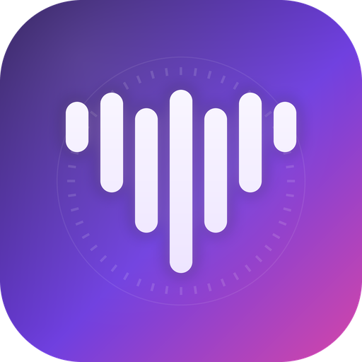

<h1 align="center">VoiceVault</h1>

<b>A local-first voice and character studio for Windows.</b> 
Free and open source, forever. No account, no subscription, no tracking.

  <a href="https://github.com/ArchAngelAries/VoiceVault/releases">Download</a> ·
  <a href="#screenshots">Screenshots</a> ·
  <a href="docs/MODEL_LICENSES.md">Models and licences</a> ·
  <a href="https://www.patreon.com/c/ArchAngelAries">Patreon</a> ·
  <a href="https://ko-fi.com/archangelaries">Ko-fi</a>

VoiceVault runs AI voice, music and chat models on your own PC. Your audio, voices and chats stay on your computer.

[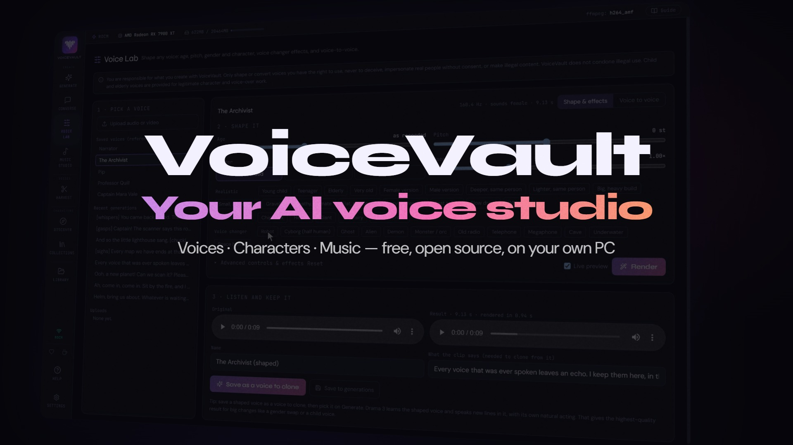](https://youtu.be/P9iKEC1qNhg)

<b>▶ <a href="https://youtu.be/P9iKEC1qNhg">Watch the trailer on YouTube</a></b> (7 min). Every voice, note and sound effect in it was made with VoiceVault, and the narrator explains how. Also available as a <a href="https://github.com/ArchAngelAries/VoiceVault/releases/download/v0.1.1/VoiceVault_trailer.mp4">download</a> with <a href="https://github.com/ArchAngelAries/VoiceVault/releases/download/v0.1.1/VoiceVault_trailer.en.srt">English captions</a>.

> **Status:** pre-release. A Windows installer is available; models download inside the app (Settings → Models).

## What it does

- **Generate** — turn text into speech in any voice. Clone a voice from a 10–30 second clip, or describe a new one in words. Multi-speaker scenes and emotion cues. The default engine is Fish Audio Drama 3.
- **Voice Lab** — change a voice's age, pitch, gender and speed, add effects, or re-voice your own performance as another voice ("voice to voice").
- **Harvest** — get a clean voice clip from a file or a public link. Remove music, isolate one speaker, remove noise and restore quality, then save it as a voice to clone.
- **Music Studio** — write full songs from lyrics and a style, edit parts of a song, split it into stems, analyse tempo and key, and make **sound effects** from a text description. Every edit makes a new take, so nothing is lost.
- **Converse and Scene Creation** — chat with AI characters, one-on-one or up to six at once, each speaking in their own voice. **Long-term memory** keeps long chats coherent, even with small local models.
- **Discover, Organize, Tier lists** — find shows, films, games and characters, save them, and rank them.
- **Library** — every piece of audio in one searchable list.
- **AI-agent tools** — let an AI agent (a local model in LM Studio, Claude Desktop or any MCP client) speak lines, reshape voices and compose music through VoiceVault. Agents can't delete or overwrite anything. See [docs/AGENT_MANUAL.md](docs/AGENT_MANUAL.md).

Built-in guides explain every page: press **Guide** at the top right of any page, or open **Help**.

## Screenshots

| | |
|---|---|
| 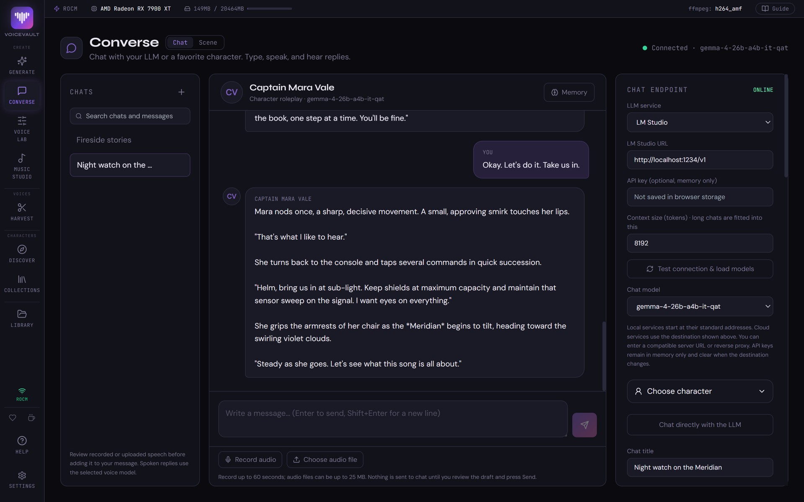 | 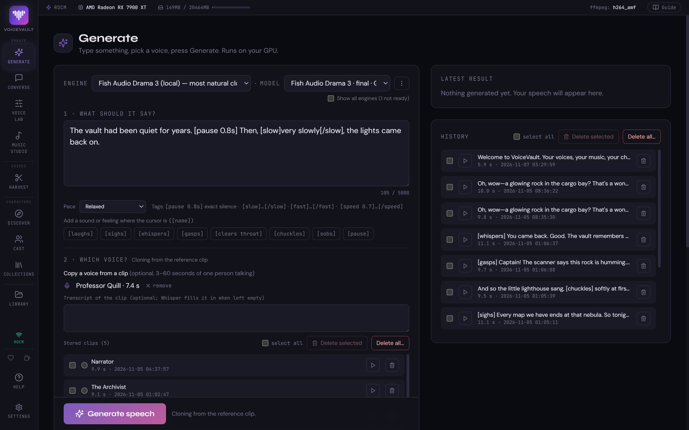 |
| **Converse:** chat with characters that remember, and hear every reply. | **Generate:** type a line, pick a voice, press Generate. |
| 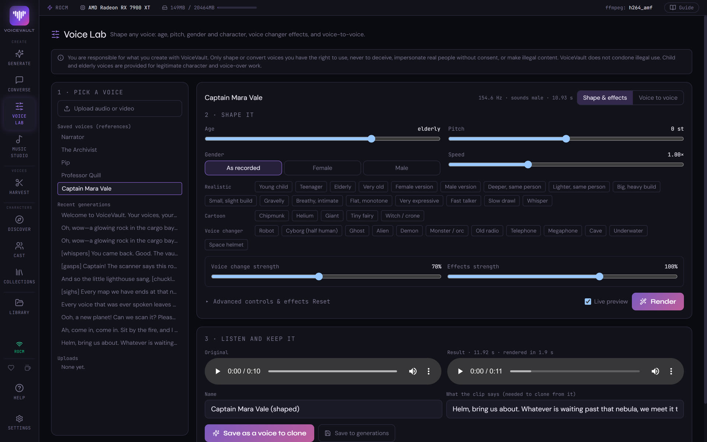 | 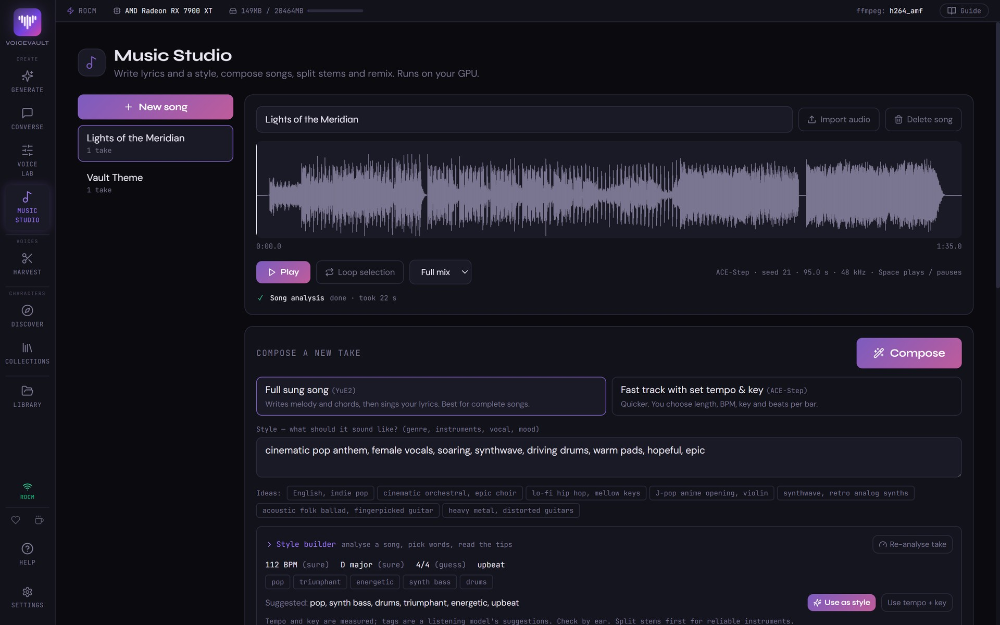 |
| **Voice Lab:** reshape a voice or turn it into a robot, a ghost or a giant. | **Music Studio:** compose songs from lyrics and a style, then measure and remix them. |
| 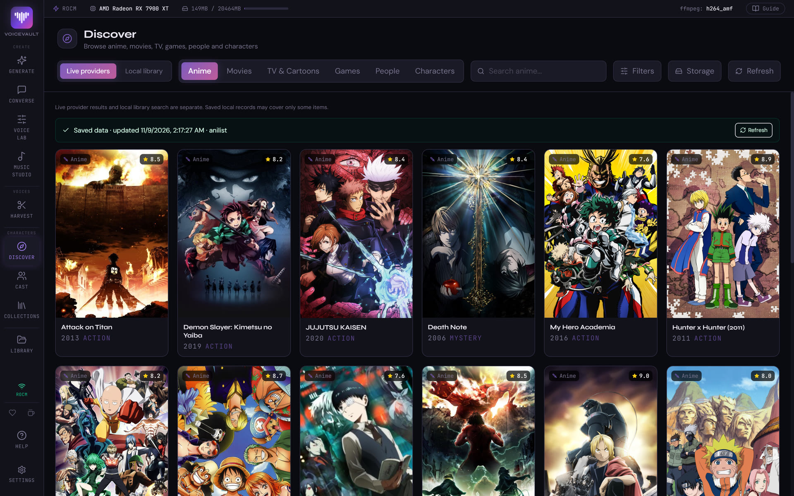 | 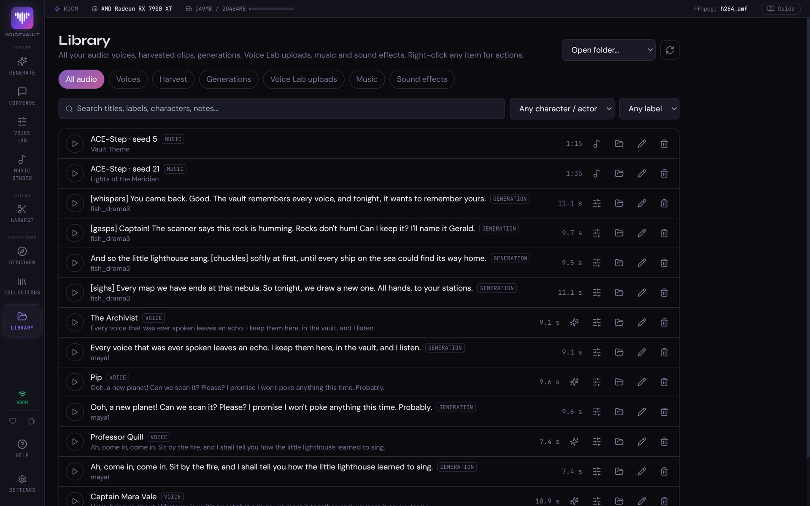 |
| **Discover:** browse and favourite shows, films, games and characters. | **Library:** every piece of audio, searchable and labelled. |
| 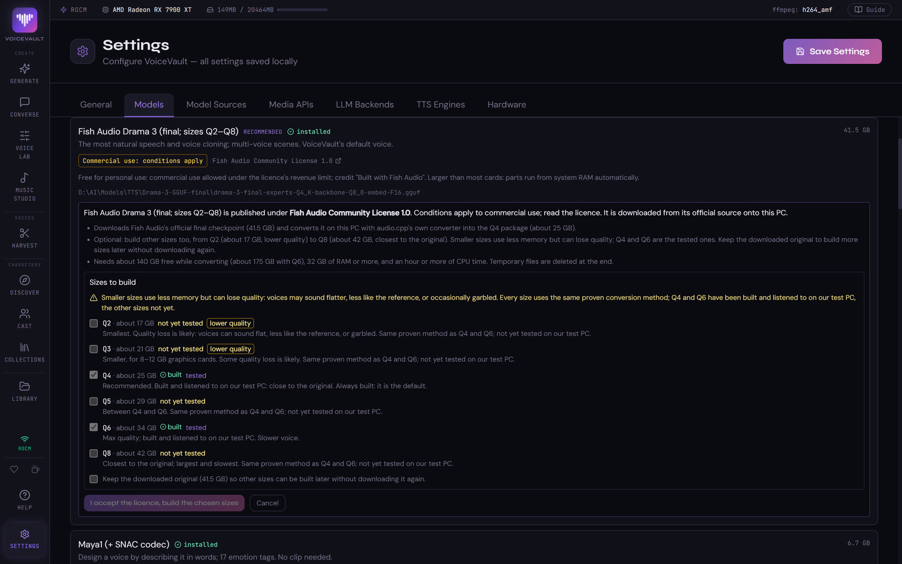 | 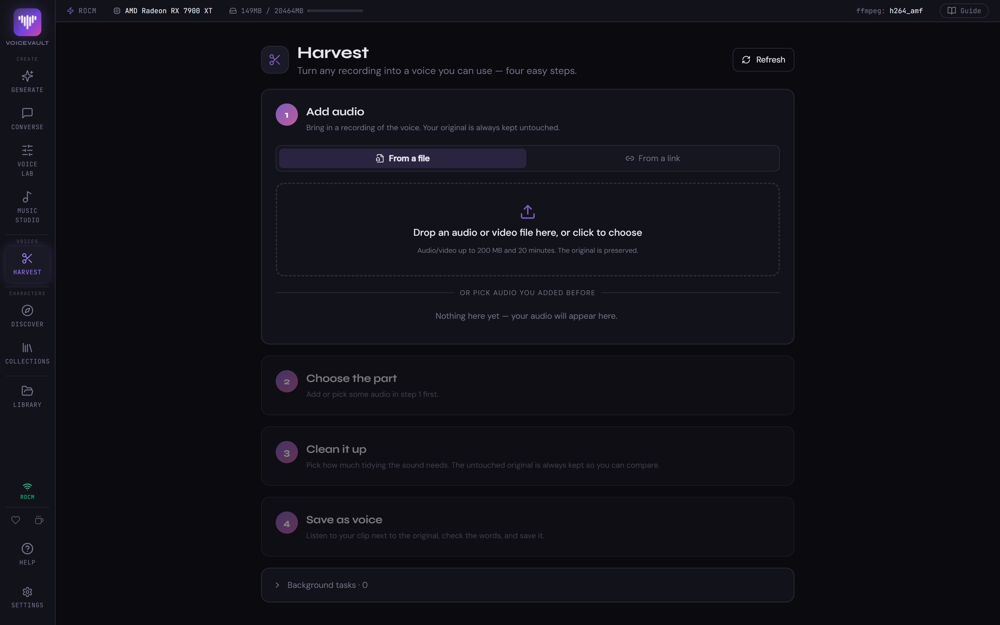 |
| **Models:** one-click downloads from official sources, with each licence shown. | **Harvest:** turn a recording into a clean voice to clone, in four steps. |

**Themes:** nine colour themes, including Daylight (light), Ocean and Pride.

| | | |
|---|---|---|
| 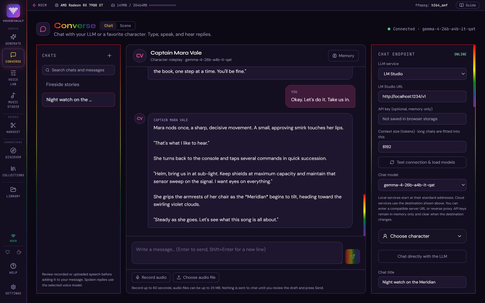 | 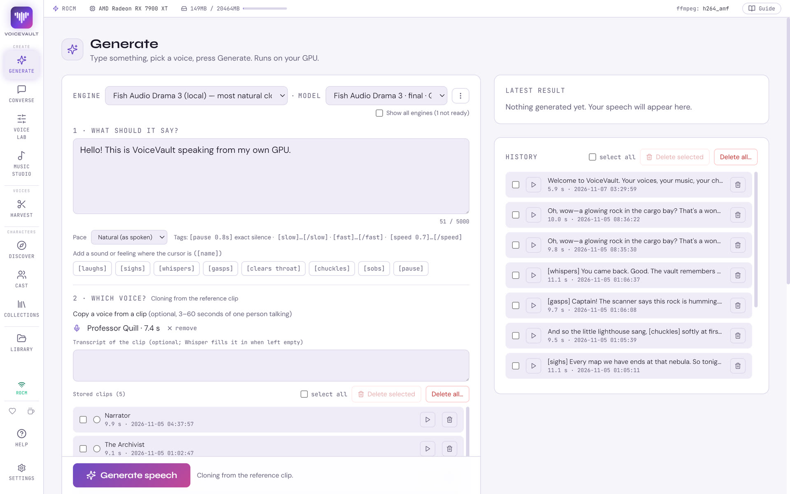 | 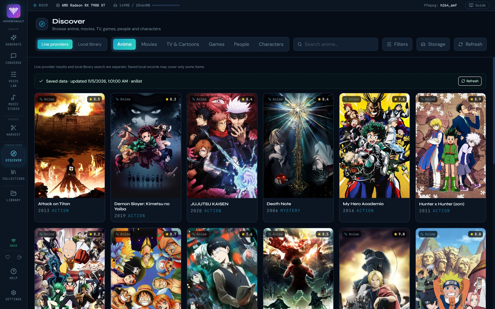 |

*Every voice in these screenshots is synthetic: designed from a text description in VoiceVault, not cloned from a real person. The characters, chats and songs are original demo content. Show and game titles and artwork come from TMDB, IGDB and AniList and belong to their owners.*

## Requirements

| | Minimum | Recommended |
|---|---|---|
| System | Windows 10 or 11, 64-bit | Windows 11 |
| Graphics card (GPU) | Optional; CPU-only works but is slow | 16 GB or more of graphics memory (VRAM) |
| Memory (RAM) | 16 GB | 32–64 GB (Drama 3 can keep part of the model in system RAM when the GPU is too small) |
| Disk space | About 30 GB for Drama 3 alone | 100 GB or more for the full set of voice and music models |
| Software | FFmpeg. With the installer nothing else is needed; building from source needs Python 3.12 and Node.js 18 or 20+ | |

**Tested hardware:**
- **AMD Radeon RX 7900 XT (20 GB)**, using Vulkan and ROCm. This is the only setup tested by the author.
- **NVIDIA** cards and **CPU-only** PCs are community-tested: they should work, but the author can't verify them. Reports are welcome: [open an issue](https://github.com/ArchAngelAries/VoiceVault/issues).
- Linux and macOS are not supported.

## Install (Windows installer)

1. Download `VoiceVault-Setup-<version>.exe` from the **[Releases page](https://github.com/ArchAngelAries/VoiceVault/releases)** and run it. It installs for your Windows account only and needs no administrator rights. You can choose the folder.
2. Start **VoiceVault** from the Start menu. The first start sets up VoiceVault's private Python engine and shows its progress. It downloads several gigabytes (Python, PyTorch for your graphics card, the voice packages, and the Prisma database engine with the small Node.js runtime it uses) and takes 10–40 minutes, once. Nothing is added to your PATH and no other program is changed.
3. Install FFmpeg if you don't have it, for example `winget install Gyan.FFmpeg`, then restart VoiceVault.
4. Get models in **Settings → Models**.

Your library, settings, models, logs and the Python engine are kept in `%LOCALAPPDATA%\VoiceVault`. Uninstalling asks before deleting them. If setup fails, the window shows **Try again** and **Repair installation**, and the details are in `%LOCALAPPDATA%\VoiceVault\logs\setup.log`. To rebuild the Python engine later, start `VoiceVault.exe --repair`.

The installer is not code-signed (certificates cost money every year, and VoiceVault is free), so Windows SmartScreen may warn on first run: choose **More info → Run anyway**. Check the download against the SHA-256 listed on the release page if you want to be sure it's genuine.

Building the installer from source: `python scripts/fetch_uv.py`, then `npm run dist:win` in `frontend` (output in `frontend/release`).

## Install from source

1. **Install the tools:**
   - Python 3.12: <https://www.python.org/downloads/>
   - Node.js (LTS): <https://nodejs.org/>. Only needed to build the app's screens.
   - FFmpeg: <https://ffmpeg.org/download.html>. Put it on your PATH (the list of folders Windows searches for programs).
2. **Download VoiceVault** from this repository (green **Code** button → Download ZIP, or `git clone https://github.com/ArchAngelAries/VoiceVault.git`) and unzip it to a folder. We'll call it `<VoiceVault folder>`.
3. **Run `setup.bat`** in `<VoiceVault folder>`. It:
   - creates a private Python environment (`venv`) so nothing else on your PC changes;
   - installs the right PyTorch for your GPU (AMD, NVIDIA or CPU);
   - installs the other Python packages;
   - builds the app's screens with Node.js.

   It can take a while the first time. To see what it would do without changing anything, run `setup.bat --dry-run`.
4. **Get the models.** Open **Settings → Models**. It lists every model VoiceVault can use, finds the ones already on your PC, and downloads the rest from their official sources after you accept each licence. It also shows whether you may sell what you make with each model. VoiceVault never ships model files itself.
5. **Start VoiceVault** with `dev_start.bat`.

## First steps

1. Open **Settings → Model Sources** and add the folders where your models are. Press **Save Settings**.
2. Go to **Generate**, press **Rescan**, choose a model, type some text and press **Generate**.
3. To clone a voice, take a clean clip of one person speaking (10–30 seconds, no music) into **Harvest**, or upload it on Generate.
4. To chat, start a local model server such as LM Studio, then connect it in **Converse**.
5. Optional: add API keys for online extras. See below.

## API keys (optional)

VoiceVault works without any keys. Some extras use online services: movie and game search, cloud chat models, the Fish Audio cloud voice. You get your own key from each service. Keys are saved only on your PC.

How to get each key, step by step: **[docs/API_KEYS.md](docs/API_KEYS.md)**.

## Privacy

- **No telemetry.** VoiceVault does not track you or send usage data anywhere.
- **Everything is local.** Audio, voices, chats and settings stay on your PC.
- **Cloud features only when you add a key.** Data goes to an online service only when you use a feature that needs it (for example Claude chat or the Fish Audio cloud voice), and then straight to that service.
- The app's backend only answers requests from your own PC.

## Models and licences

VoiceVault never redistributes model weights. You download each model from its official source, and each has its own licence. Some are **non-commercial** (OmniVoice, Breeze TTS 2, YuE2, SheetSage2), and some are free only below a revenue limit (Drama 3, Stable Audio 3).

Full table with links: **[docs/MODEL_LICENSES.md](docs/MODEL_LICENSES.md)**.

**Built with Fish Audio.** VoiceVault's default voice engine is Fish Audio Drama 3, under the Fish Audio Community License.

## Terms of use

VoiceVault is a tool. You are responsible for what you create with it and must follow the law. It comes with no warranty. Read the full terms: **[docs/TERMS_OF_USE.md](docs/TERMS_OF_USE.md)**. The app shows a short version on first start.

## More documentation

- [docs/API_KEYS.md](docs/API_KEYS.md) — getting and adding API keys
- [docs/MODEL_LICENSES.md](docs/MODEL_LICENSES.md) — every model, its licence and download page
- [docs/TERMS_OF_USE.md](docs/TERMS_OF_USE.md) — terms of use
- [CHANGELOG.md](CHANGELOG.md) — what changed in each release
- [CREDITS.md](CREDITS.md) — thank you to every model, library and data provider VoiceVault builds on
- [docs/HARDWARE_MATRIX.md](docs/HARDWARE_MATRIX.md) — measured speed on different graphics cards and CPU-only
- [docs/AGENT_MANUAL.md](docs/AGENT_MANUAL.md) — connecting AI agents (MCP)
- [docs/CHAT_MEMORY.md](docs/CHAT_MEMORY.md) — how long-term chat memory works
- [docs/VOICE_LAB.md](docs/VOICE_LAB.md), [docs/HARVEST_CLEANING.md](docs/HARVEST_CLEANING.md), [docs/MUSIC_STUDIO.md](docs/MUSIC_STUDIO.md) — feature details

## Support VoiceVault

VoiceVault is free and always will be, with no ads and no tracking. If it's useful to you, you can support its development:

- [Patreon](https://www.patreon.com/c/ArchAngelAries)
- [Ko-fi](https://ko-fi.com/archangelaries)

The same two links sit at the bottom of the app's sidebar. Supporting is optional and unlocks nothing: every feature is free for everyone.

## Licence

VoiceVault is **free and open source, forever**, under the **GNU Affero General Public License v3.0** ([LICENSE](LICENSE)).

- You can use, study, change and share it, free.
- Anything built from VoiceVault must stay free and open under the same licence, with its full source code. That includes apps and websites that run it for others. Nobody can turn it into a closed, paywalled product.
- **What you create with VoiceVault is yours.** You can sell your audio, music and voices, *as far as the models you used allow*. Each engine shows whether commercial use is allowed (yes / no / limited) before you generate. See [docs/MODEL_LICENSES.md](docs/MODEL_LICENSES.md).
- The name "VoiceVault" and its logo are covered by [TRADEMARK.md](TRADEMARK.md): forks are welcome under their own name.
- Third-party code and models keep their own licences. VoiceVault never redistributes model weights.
